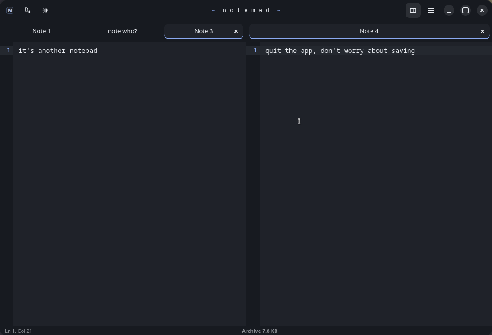

# notemad

A simple tabbed note editor for Linux that never asks you to save. Notes are written
to disk as you type, and closing the application and reopening it puts you back
where you were. So the same tabs are in the same order, the same one in front, the
cursor and the scroll position where you left them etc.

Files you open from disk are treated differently. Unsaved changes are held in a
private draft that survives a restart, but the file itself is never written
until you press Ctrl+S.

I made this for two reasons; a lot of friends have switched from Windows to Linux recently
(about time) and wanted a simple Notepad++ replacement, but mostly because I often have 
XFCE's mousepad open with ~10 random notes or log snippets, and it's annoying when I come
to update and reboot my machine.

The application is built in Python, with GTK4, libadwaita and GtkSourceView. It is not flashy,
it does not have all the features I want yet, but it does the job I want for now, and I am very 
happy with v1.

I'm looking forward to expanding on this, both feature-wise, and distro/OS support. I'd love any feedback.



## Requirements

Python 3.11 or newer, GTK 4.12, libadwaita 1.5 and GtkSourceView 5.

On Arch and derivatives (I'm an Arch-lite user, EndeavourOS is incredible):

```
sudo pacman -S python python-gobject gtk4 libadwaita gtksourceview5
```

On Fedora:

```
sudo dnf install python3-gobject gtk4 libadwaita gtksourceview5
```

On Debian 13 (trixie), Ubuntu 24.04 or newer, and their derivatives, where the
introspection typelibs are separate packages and none of them arrive by
default:

```
sudo apt install python3-gi gir1.2-gtk-4.0 gir1.2-adw-1 gir1.2-gtksource-5
```

Trixie ships libadwaita 1.7, which has no `ShortcutsDialog`, so the keyboard
shortcuts come up as a plain list rather than the newer searchable window. It
lists exactly the same keys.

Debian 12 (bookworm) is out of reach: GTK 4.8 and libadwaita 1.2 are missing
most of the dialogs notemad is built out of.

I made notemad on EndeavourOS. The versions above were checked on Debian 13
and Fedora KDE Plasma VMs, which is not the same as true testing, which I plan to do.

## Running it

From a clone, with the system packages above installed:

```
python -m notemad
```

Any files named on the command line open as tabs alongside the restored
session.

## Installing

On Arch systems, `uv tool install .` is enough to get the command.

It is not enough on Debian or Fedora. `uv` builds an isolated environment that
cannot see the system Python packages, so it goes to PyPI for PyGObject, which
ships only as source and wants a C compiler and a pile of headers. Both distros
already package PyGObject, so the current way is to use that copy:

```
python3 -m venv --system-site-packages ~/.local/share/notemad-venv
~/.local/share/notemad-venv/bin/pip install --no-deps .
ln -s ~/.local/share/notemad-venv/bin/notemad ~/.local/bin/notemad
```

`--system-site-packages` is what lets the venv see the distro's PyGObject, and
`--no-deps` is what stops pip fetching another one.

Either gives you the command but not a menu entry. For that, put the
desktop file and the icon where your desktop looks for them:

```
install -Dm644 data/io.gitlab.efferone.Notemad.desktop \
  ~/.local/share/applications/io.gitlab.efferone.Notemad.desktop
install -Dm644 notemad/data/icons/hicolor/scalable/apps/io.gitlab.efferone.Notemad.svg \
  ~/.local/share/icons/hicolor/scalable/apps/io.gitlab.efferone.Notemad.svg
```

One issue with these workarounds, the command lands in `~/.local/bin`, which is on
the PATH of a login shell but often not on the PATH the desktop session was
started with. XFCE's Whisker Menu (XFCE best DE btw) hides any entry whose command it cannot find,
so notemad goes missing from the menu while running fine from a terminal.
Either put `~/.local/bin` on the session PATH, or point the installed desktop
file at the full path:

```
sed -i "s|^Exec=notemad|Exec=${HOME}/.local/bin/notemad|" \
  ~/.local/share/applications/io.gitlab.efferone.Notemad.desktop
```

It's not perfect, but it is a work-around for now until I get a better solution..


## What it does

So the main "feature" is that nothing is lost when you don't save. 
Typing stops for half a second and the buffer is written out. 
For really large notes, the buffer save is a wee bit less
often, in this case then a warn will display.

Closing a tab is not throwing it away, instead it goes to *the archive*! with a
preview, a search box and a date, and Ctrl+Shift+T brings back the last one.
The status bar shows what the archive is taking up on disk (space used) and changes 
colour once it is past a size you choose. Nothing is ever removed from it without 
being prompted.

The window splits in two, standard split view..notes can be moved between the panes, 
and the arrangement of notes/tabs is part of the session like everything else.

Search runs across every note at once, open and closed, reporting the line each
hit is on. What gets searched is what is on screen, so a file with unsaved
changes is matched through its draft not through the copy on disk.

Only one copy runs against a set of notes at a time. A second instance of the app
won't start to prevent two copies writing over each other. It will name the process
holding the lock.

There is a dark theme (recommended) and a light one (at your own peril), 
chosen in the preferences or switched with the button in the header.


## Keyboard

| Action | Binding |
|---|---|
| New note | Ctrl+N |
| Open file | Ctrl+O |
| Recover the last closed note | Ctrl+Shift+T |
| Save | Ctrl+S |
| Save as | Ctrl+Shift+S |
| Rename note | F2 |
| Close tab | Ctrl+W |
| Find, and close the bar again | Ctrl+F |
| Find and replace | Ctrl+H |
| Search every note | Ctrl+Shift+F |
| Next tab | Ctrl+Tab |
| Previous tab | Ctrl+Shift+Tab |
| Jump to a tab | Alt+1 to Alt+9 |
| Split the window | Ctrl+backslash |
| Move note to the other pane | Ctrl+Shift+M |
| Switch dark and light | Ctrl+D |
| Preferences | Ctrl+, |
| Quit | Ctrl+Q |

All of it is in the menu behind the button at the right of the header.


## Where everything lives

Everything follows the XDG base directory specification. The defaults:

```
~/.local/share/notemad/notes/              notes written in notemad
~/.local/share/notemad/archive/            notes from tabs you have closed
~/.local/share/notemad/archive/index.json  what each archived note was called
~/.local/share/notemad/lock                held by the copy that is running
~/.local/state/notemad/drafts/             unsaved changes to files opened from disk
~/.local/state/notemad/session.json        open tabs and where you left off
~/.config/notemad/config.json              preferences
```

All of it is plain text you can read with anything (vim etc). Notes are one file each 
and named by a UUID, in dirs created private to you.

A note's title lives in the session, and closing a tab throws that entry away, 
so the archive keeps its own index of names and dates alongside the files. 
Lose the index and you still have every note, just *without the names*.

Every write goes to a temp file in the same directory, gets flushed and
then moved into place. The idea being that a crash partway through leaves 
the previous contents instead of half a note. A session file that can't be read 
is moved to the side as a `.bak` and notemad starts empty otherwise it could
fail to open.

## Security

notemad stores plain text with no encryption: anything that can read your files
can read your notes. `SECURITY.md` is the record of a review of the code, what
it turned up and what was done about it, written to be read without knowing the
code. I used a AI/GenAI prompt from Reddit for some of the bug testing, when I find 
the author I will upload the prompt with their name on it (cheers!). It wasn't all 
relevant, but I threw the prompt into Claude Code and asked it to work through
the checks with me, it actually did really well, if a wee bit over-zealous.

## AI assistance

notemad was heavily written with Claude Code, when I started the project I realised
two things: that my Python was lacking, and that CC can fire through a lot of the basic
code a lot faster than me, and as the intended audience for this wee application is
myself, I was happy to work with AI and bash it out.

I wrote a plan and a to-do list, tweaked both a couple of times, and work with CC 
in small pieces **reviewed** and committed one at a time. There was a lot of..discussion
about the code base and some things I didn't like about how it wrote code, my tweaks
and rewrites probably stick out like a sore thumb.

The design decisions, the arguments about them, and the responsibility 
for what is here are mine. It seems more useful to say so than not.

## Licence

GNU General Public License v3.0 or later. The full text is in `LICENSE`.


## Benny Harvey, RIP

Gone but not forgotten, miss you big man.
